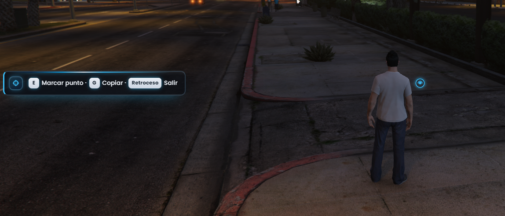
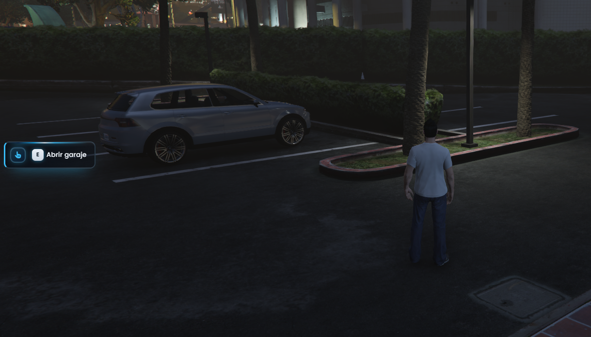
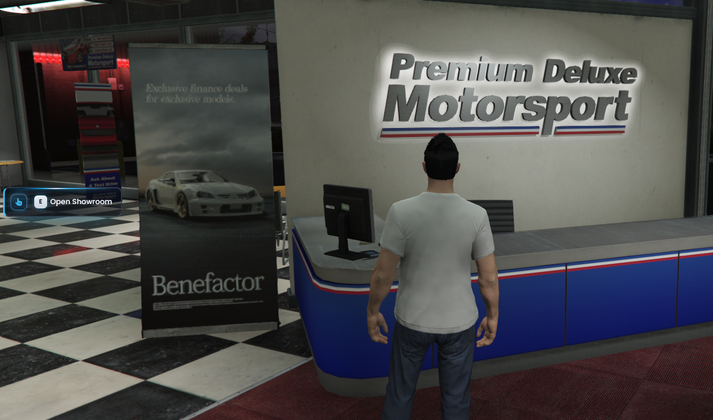
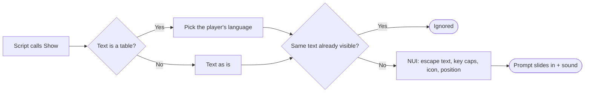

<div align="center">



<br>


**Interaction prompts ("[E] Open the garage") for FiveM in JVL Steel Blue.**
Same idea as ox_lib's `lib.showTextUI`, with key caps, the player's own language and almost everything configurable.

[Features](#-features) · [How it works](#-how-it-works) · [Installation](#-installation) · [API](#-api) · [Commands](#-commands) · [License](#-license)

</div>

---

## ✨ Features

<table>
<tr>
<td width="50%" valign="top">

### ⌨️ Key caps
Write `[E]`, `[H]` or `[SHIFT]` in the text and they are drawn as key caps (silver, blue or outline). `**bold**` and `~n~` line breaks are supported too.

### 🌐 Automatic language
`Config.Locale = 'auto'` uses the language each player has in GTA V (es, en, fr, de, pt included). Other scripts can send `{ es = '…', en = '…' }` and every player sees their own.

### 🎛️ Highly configurable
Background (translucent / solid), accent color, left bar, light line, glow, borders, radius, sizes, padding, font, uppercase, margins, key cap style, icon (default, size, color, animation), enter animation and its speed, sounds.

</td>
<td width="50%" valign="top">

### 📍 9 positions
`left-center`, `right-center`, `top-center`, `bottom-center`, the four corners and `center`, per prompt or as default. Players can move theirs with `/textui position` (saved on their PC).

### 🔇 No spam
The same text shown again while visible is ignored, so zones do not restart the sound or the animation every frame. Optional auto-hide after a duration.

### 🧩 Standalone
No framework, no ox_lib and no other resource required. Every JVL script uses it first and falls back to ox_lib when it is not running.

</td>
</tr>
</table>

## 📸 Preview

<div align="center">
<br>
<sub>Several actions in one prompt, each with its own key cap (long keys like Backspace fit too)</sub>
<br><br>
<table>
<tr>
<td align="center"><br><sub>Garage prompt in the player's language (Spanish)</sub></td>
<td align="center"><br><sub>Same style for a third-party script (English text)</sub></td>
</tr>
</table>
</div>

## 🔄 How it works



The look comes from `config.lua`: the client sends it once to the NUI, which turns it into CSS variables. The text is always HTML-escaped before formatting, so a caller can never inject HTML.

<details>
<summary><b>📁 Project structure</b></summary>

<br>

| Path | Contents |
| --- | --- |
| `fxmanifest.lua` | Resource manifest (no dependencies) |
| `config.lua` | Language, position, margins, style, key caps, icon, animation, repeat, sounds, command |
| `locales/*.lua` | Texts of the command (es, en, fr, de, pt) |
| `client.lua` | Exports, language detection, auto-hide, command |
| `web/` | NUI (`index.html`, `style.css`, `script.js`, `jvl-steel-blue.css`) |
| `sounds/` | `show.ogg`, `hide.ogg` |
| `assets/readme/` | README banner (not loaded in game) |

</details>

<details>
<summary><b>🔐 Configuration</b></summary>

<br>

```lua
Config.Locale = 'auto'           -- 'auto' | 'es' | 'en' | 'fr' | 'de' | 'pt'
Config.DefaultPosition = 'left-center'
Config.PlayersCanMove = true

Config.Style = {
    background = 'translucent',  -- 'translucent' | 'solid'
    accent = '#38bdf8',
    accentBar = true, lightLine = true, glow = true,
    borderWidth = 2, radius = 11, minWidth = 180, maxWidth = 420,
    font = 'Poppins', fontSize = 13.5, fontWeight = 500, uppercase = false,
}

Config.KeyCaps = { enabled = true, style = 'silver' } -- 'silver' | 'blue' | 'outline'
Config.Icon = { enabled = true, default = 'fa-solid fa-hand-pointer', size = 32, animation = nil }
Config.Animation = { type = 'slide', duration = 220 } -- 'slide' | 'fade' | 'scale' | 'none'
Config.Sounds = { enabled = true, volume = 0.35, show = 'show.ogg', hide = 'hide.ogg' }
```

</details>

## 🚀 Installation

1. Copy `jvl_textui` into your resources folder.
2. Add it to `server.cfg` (no dependencies):

```cfg
ensure jvl_textui
```

3. In your scripts, use it first with ox_lib as fallback:

```lua
if GetResourceState('jvl_textui') == 'started' then
    exports.jvl_textui:Show('[E] Open the garage', { icon = 'fa-solid fa-warehouse' })
else
    lib.showTextUI('[E] Open the garage')
end
```

## 🧪 API

```lua
-- text: string or { es = '…', en = '…' }
-- options: { position, icon, iconColor, iconAnimation, duration } (or just a duration in ms)
exports.jvl_textui:Show('[E] Abrir el garaje', { icon = 'fa-solid fa-warehouse', position = 'right-center' })
exports.jvl_textui:Show({ es = '[E] Abrir', en = '[E] Open' })
exports.jvl_textui:Hide()

local open, text = exports.jvl_textui:IsOpen()
local locale = exports.jvl_textui:GetLocale()   -- 'es', 'en'…

-- ox_lib style names also exist: showTextUI, hideTextUI, isTextUIOpen
TriggerClientEvent('jvl_textui:show', source, '[E] Talk', { duration = 4000 }) -- from the server
```

## 🎮 Commands

| Command | Description |
| --- | --- |
| `/textui test` | Shows an example prompt for 5 seconds |
| `/textui hide` | Hides the current prompt |
| `/textui position <name>` | Moves your prompt (saved; needs `Config.PlayersCanMove`) |
| `/textui lang` | Prints the detected language |

---

## 📄 License

Released under the **MIT License** — free to use, modify and share, keeping the copyright notice. See [`LICENSE`](LICENSE).

© 2026 JVL MediaCode

---

<div align="center">

Made by **[JVL MediaCode](https://jvlmediacode.com)** · Jose M. Valenzuela · Meoqui, Chihuahua, México

<sub><a href="mailto:contacto@jvlmediacode.com">contacto@jvlmediacode.com</a> · <a href="https://discord.gg/m2spgxkPfj">Discord</a></sub>

</div>
